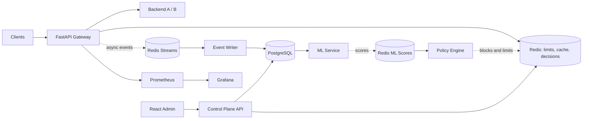

# Architecture and module plan

## Request path

Client → FastAPI gateway → route and identity lookup → Redis rate limiter / adaptive decisions → selected backend. The gateway emits request events to Redis Streams; background consumers persist traffic history in PostgreSQL. The ML service reads historical windows outside the request path. The policy engine publishes temporary block and limit decisions to Redis for the gateway to read.

## Services

- `gateway/`: public proxy, auth, rate limiting, balancing, telemetry
- `control_plane/`: route, backend, key, policy administration API
- `ml_service/`: feature extraction, anomaly scoring, forecasting
- `policy_engine/`: adaptive protection worker
- `dashboard/`: React admin UI
- `backends/`: adjustable demo upstreams
- `infra/`: Compose dependencies and observability configuration

## Delivery sequence

The eight modules in the README land as separate commits so each increment is reviewable. This is a local development stack; production secrets and deployment hardening remain follow-up work.

## Component map

## Evaluation

Run identical Locust normal, flash crowd, and bot scenarios against a static baseline and adaptive policy, exporting CSV from each run. `loadtests/evaluate.py` joins the aggregate Locust rows and writes a comparison table and graph. `loadtests/evaluate_ml.py` reports held-out synthetic normal/bot precision, recall, and F1. These scripts make the evaluation reproducible; the baseline numbers should be filled from a running Docker environment rather than guessed.
